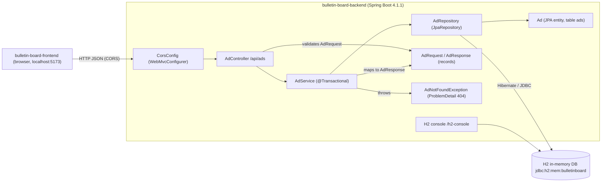
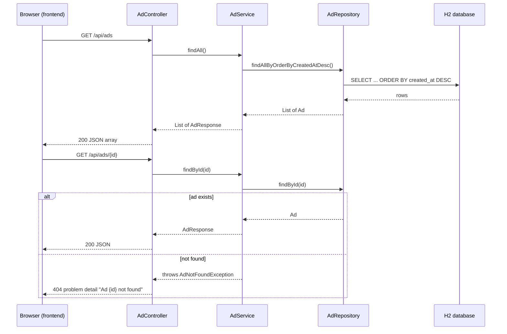
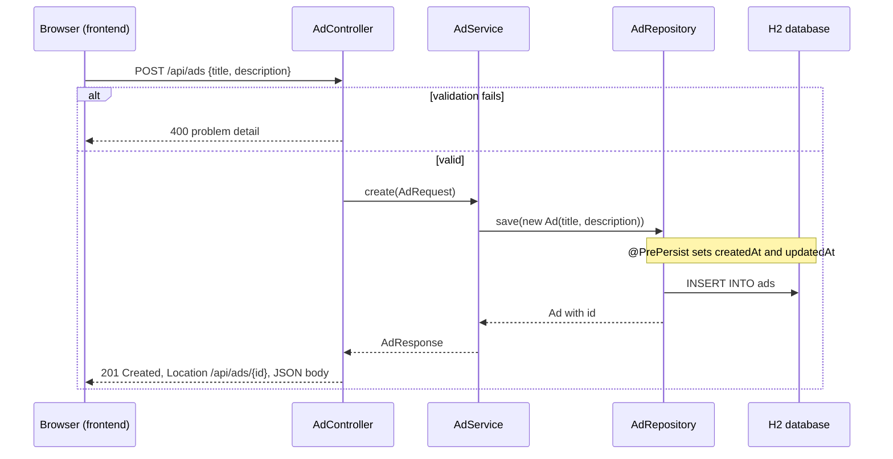
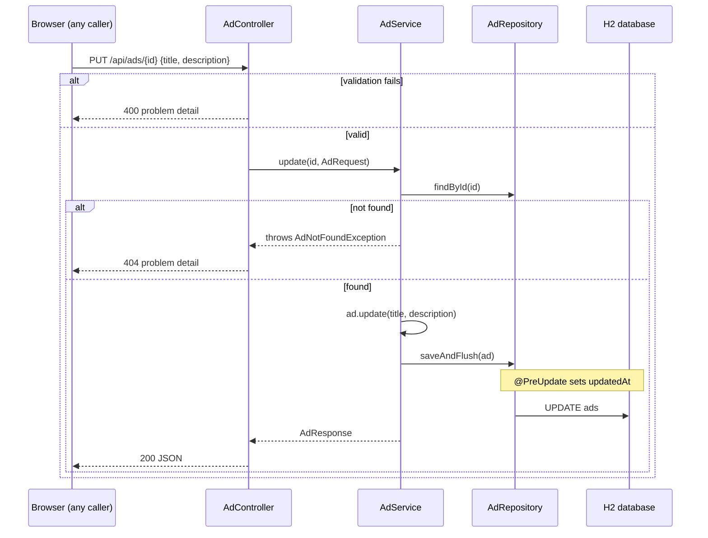

# Architecture: bulletin-board-backend

## Architecture Analysis

### System Overview

A single Spring Boot 4.1.1 application (Java 25) that exposes a JSON REST API under `/api/ads` and persists ads in an in-memory H2 database through Spring Data JPA. It is one half of the bulletin board; the other half is the React/Vite single-page app in `bulletin-board-frontend`, which calls this API cross-origin from `http://localhost:5173`.

### Architectural Style

**Monolith, layered within a feature package.** Evidence:
- One Maven module, one deployable (`spring-boot-maven-plugin`), one `@SpringBootApplication` class.
- The `ad` package holds a full vertical slice: `AdController` (web) -> `AdService` (transactions and business logic) -> `AdRepository` (data access) -> `Ad` (JPA entity), with `AdRequest`/`AdResponse` records at the API boundary.
- Cross-cutting configuration sits in a separate `config` package (`CorsConfig`).
- No messaging, no external service calls, no scheduled jobs, no security layer.

### Component Relationships

Text fallback: The frontend calls the backend over HTTP JSON; CORS rules from `CorsConfig` apply to `/api/**`. `AdController` validates the `AdRequest` body and delegates to `AdService`. `AdService` uses `AdRepository` (Spring Data JPA) to load and save the `Ad` entity in the in-memory H2 database, maps entities to `AdResponse`, and throws `AdNotFoundException` (a 404 problem detail) for unknown ids. The H2 web console reads the same database directly.

### Data Flow

1. A browser request from the frontend origin reaches the embedded servlet container; Spring MVC applies the CORS mapping for `/api/**` (origins from `app.cors.allowed-origins`, methods `GET, POST, PUT`).
2. `AdController` binds JSON to `AdRequest` and runs Bean Validation (`@Valid`); failures become a 400 problem-details response from Spring's default handling (`spring.mvc.problemdetails.enabled=true`).
3. `AdService` runs inside a transaction (class-level read-only; `create` and `update` are read-write), calls `AdRepository`, and maps `Ad` to `AdResponse` while the transaction is open (`spring.jpa.open-in-view=false`).
4. Hibernate writes to H2; `@PrePersist`/`@PreUpdate` on `Ad` set `createdAt`/`updatedAt`. `update` uses `saveAndFlush` so `updatedAt` is set before the response is built.
5. The response is serialized to JSON (`id, title, description, createdAt, updatedAt`).

### Key Design Decisions

| Decision | Evidence | Implication |
|---|---|---|
| Feature-package slice (`ad/`) | package layout | New features (e.g. accounts) can be added as sibling packages without touching `ad/` internals |
| DTO records at the boundary | `AdRequest`, `AdResponse` | The entity is never serialized directly; adding fields to the API is an explicit change in `AdResponse.from` |
| RFC 9457 problem details for errors | `application.properties`, `AdNotFoundException` | Consistent error shape the frontend can rely on |
| Schema generated by Hibernate, `create-drop`, in-memory H2 | `application.properties` | Zero setup, but no persistence across restarts and no migration history |
| `open-in-view=false`, class-level `@Transactional(readOnly = true)` | `application.properties`, `AdService` | Lazy-loading is confined to the service layer; mapping happens inside the transaction |
| CORS via `WebMvcConfigurer` | `CorsConfig` | CORS is enforced by Spring MVC, not by a security filter chain (there is none) |
| No authentication or authorization | no security dependency in `pom.xml` | Every endpoint, including writes and the H2 console, is open to any caller |

### Improvement Opportunities

- Introduce a security layer (the active intent) and decide how it coexists with the MVC-level CORS configuration and the H2 console.
- Replace `ddl-auto=create-drop` on in-memory H2 with a durable store and versioned migrations if data must survive restarts.
- Add pagination to `GET /api/ads`.
- Add a global exception handler only if custom error types grow beyond the single not-found case.

## Interaction Diagrams

### Browse and view ads

Text fallback: `GET /api/ads` goes controller -> service -> repository -> H2 and returns all ads newest first with 200. `GET /api/ads/{id}` returns 200 with the ad, or 404 with a problem detail when the id does not exist.

### Create an ad

Text fallback: `POST /api/ads` validates the body (400 on failure), then the service saves a new `Ad`; the entity callback stamps both timestamps; the controller answers 201 with a `Location` header and the created ad. No caller identity is checked or recorded.

### Edit an ad

Text fallback: `PUT /api/ads/{id}` validates the body, loads the ad (404 if missing), overwrites title and description, flushes so `updatedAt` is refreshed, and returns 200. Any caller can edit any ad; there is no ownership check. This is the gap the active intent addresses.
