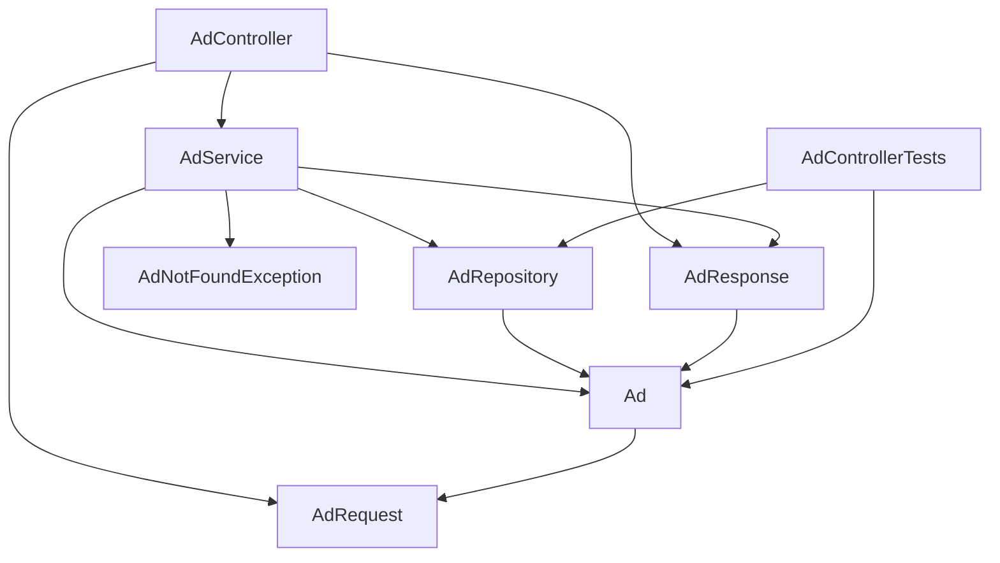

# Component Inventory: bulletin-board-backend

Twelve source components (ten main, two test). Paths are relative to `src/main/java/com/example/bulletinboard/` or `src/test/java/com/example/bulletinboard/` unless stated.

## Summary

| Component | Type | Location | Depends on |
|---|---|---|---|
| BulletinBoardBackendApplication | Bootstrap | `BulletinBoardBackendApplication.java` | Spring Boot |
| AdController | REST controller | `ad/AdController.java` | AdService, AdRequest, AdResponse |
| AdService | Service | `ad/AdService.java` | AdRepository, Ad, AdRequest, AdResponse, AdNotFoundException |
| AdRepository | Repository | `ad/AdRepository.java` | Ad, Spring Data JPA |
| Ad | JPA entity | `ad/Ad.java` | AdRequest (length constants), Jakarta Persistence |
| AdRequest | Input DTO | `ad/AdRequest.java` | Jakarta Validation |
| AdResponse | Output DTO | `ad/AdResponse.java` | Ad |
| AdNotFoundException | Error type | `ad/AdNotFoundException.java` | Spring Web `ErrorResponseException` |
| CorsConfig | Configuration | `config/CorsConfig.java` | `app.cors.allowed-origins` property, Spring MVC |
| application.properties | Configuration | `src/main/resources/application.properties` | — |
| BulletinBoardBackendApplicationTests | Test | `BulletinBoardBackendApplicationTests.java` | full application context |
| AdControllerTests | Test | `ad/AdControllerTests.java` | MockMvc, AdRepository, Ad |

## Components

### BulletinBoardBackendApplication

- **Responsibility**: `@SpringBootApplication` entry point; `main` starts the app; enables component scanning under `com.example.bulletinboard`.
- **Dependencies**: Spring Boot auto-configuration.

### AdController

- **Responsibility**: HTTP adapter for `/api/ads`: `list()` (GET), `get(id)` (GET `/{id}`), `create(request)` (POST, 201 + `Location`), `update(id, request)` (PUT `/{id}`). Triggers Bean Validation with `@Valid`.
- **Dependencies**: AdService (constructor-injected), AdRequest, AdResponse, `ServletUriComponentsBuilder`.
- **Security**: none; no principal parameter, no annotations.

### AdService

- **Responsibility**: business operations and transaction boundary. `findAll`, `findById`, `create`, `update`; private `getAd` throws AdNotFoundException. Class-level `@Transactional(readOnly = true)`; `create`/`update` read-write. `update` calls `saveAndFlush` so `@PreUpdate` runs before mapping.
- **Dependencies**: AdRepository, Ad, AdRequest, AdResponse, AdNotFoundException.
- **Security**: none; no ownership check in `update`.

### AdRepository

- **Responsibility**: data access for `Ad`; `JpaRepository<Ad, Long>` plus `findAllByOrderByCreatedAtDesc()`.
- **Dependencies**: Ad, Spring Data JPA.

### Ad

- **Responsibility**: JPA entity mapped to table `ads`: `id` (IDENTITY), `title` (not null, length 100), `description` (not null, length 2000), `createdAt` (not null, not updatable), `updatedAt` (not null). `@PrePersist`/`@PreUpdate` stamp times; `update(title, description)` mutator; protected no-arg constructor.
- **Dependencies**: AdRequest length constants, Jakarta Persistence.
- **Note**: no owner/author field.

### AdRequest

- **Responsibility**: request record `(title, description)` with `@NotBlank` and `@Size(max)`; defines `TITLE_MAX_LENGTH = 100` and `DESCRIPTION_MAX_LENGTH = 2000`.
- **Dependencies**: Jakarta Validation.

### AdResponse

- **Responsibility**: response record `(id, title, description, createdAt, updatedAt)`; package-private `from(Ad)` mapper.
- **Dependencies**: Ad.

### AdNotFoundException

- **Responsibility**: `ErrorResponseException` producing a 404 `ProblemDetail` with detail `Ad {id} not found`.
- **Dependencies**: Spring Web.

### CorsConfig

- **Responsibility**: `WebMvcConfigurer` that maps `/api/**` to the configured allowed origins and methods `GET, POST, PUT`.
- **Dependencies**: `app.cors.allowed-origins` (String array via `@Value`), Spring MVC `CorsRegistry`.

### application.properties

- **Responsibility**: app name; H2 in-memory datasource `jdbc:h2:mem:bulletinboard`; `ddl-auto=create-drop`; `open-in-view=false`; H2 console enabled; problem details enabled; `app.cors.allowed-origins=http://localhost:5173`.
- **Dependencies**: none.

### BulletinBoardBackendApplicationTests

- **Responsibility**: `@SpringBootTest` smoke test that the application context loads.
- **Dependencies**: full application context.

### AdControllerTests

- **Responsibility**: `@SpringBootTest` + `@AutoConfigureMockMvc` integration tests: create (201, Location, body), invalid create (400), update (200), update missing (404 + detail), list newest first, CORS preflight from `http://localhost:5173`. Clears the repository before each test.
- **Dependencies**: MockMvc, AdRepository, Ad, H2.

## Dependency Graph (internal)

Text fallback: AdController uses AdService, AdRequest and AdResponse. AdService uses AdRepository, Ad, AdResponse and AdNotFoundException. AdRepository and AdResponse depend on Ad; Ad reuses AdRequest's length constants. AdControllerTests uses AdRepository and Ad directly. No circular dependencies. CorsConfig and BulletinBoardBackendApplication have no dependencies on other application classes.
