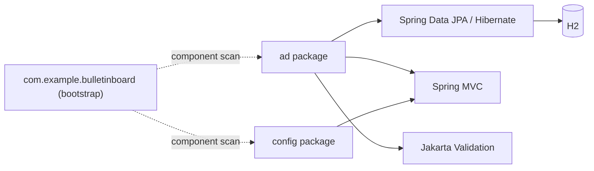

# Dependencies: bulletin-board-backend

## External Dependencies (pom.xml)

All versions are managed by the parent `org.springframework.boot:spring-boot-starter-parent:4.1.1`; `pom.xml` declares none explicitly.

| GroupId:ArtifactId | Scope | Purpose |
|---|---|---|
| `org.springframework.boot:spring-boot-h2console` | compile | H2 web console auto-configuration |
| `org.springframework.boot:spring-boot-starter-data-jpa` | compile | Spring Data JPA + Hibernate |
| `org.springframework.boot:spring-boot-starter-validation` | compile | Jakarta Bean Validation |
| `org.springframework.boot:spring-boot-starter-webmvc` | compile | Spring MVC + embedded servlet container + Jackson |
| `com.h2database:h2` | runtime | in-memory database |
| `org.springframework.boot:spring-boot-starter-data-jpa-test` | test | JPA testing support |
| `org.springframework.boot:spring-boot-starter-validation-test` | test | validation testing support |
| `org.springframework.boot:spring-boot-starter-webmvc-test` | test | MockMvc, JUnit, Hamcrest, JsonPath |

Build plugin: `org.springframework.boot:spring-boot-maven-plugin` (version from parent).

Dependency health: no explicit version overrides, no duplicate or conflicting declarations, no outdated major versions (Boot 4.1.x is current). No security advisory check was run (no build or dependency resolution performed in this scan).

## External Runtime Dependencies

| Dependency | Kind | Notes |
|---|---|---|
| H2 in-memory database | embedded, same JVM | no external database server |
| `bulletin-board-frontend` | consumer | calls the API from origin `http://localhost:5173` (CORS allow-list) |
| Maven Central (`repo.maven.apache.org`) | build-time | Maven distribution and artifacts |

No outbound calls to external services, queues, or cloud APIs.

## Configuration Dependencies

| Key | Default | Consumed by |
|---|---|---|
| `app.cors.allowed-origins` | `http://localhost:5173` | `CorsConfig` (required; startup fails if missing) |
| `spring.datasource.url` | `jdbc:h2:mem:bulletinboard` | Spring Boot datasource |
| `spring.jpa.hibernate.ddl-auto` | `create-drop` | Hibernate schema generation |
| `spring.jpa.open-in-view` | `false` | Spring MVC/JPA |
| `spring.h2.console.enabled` | `true` | H2 console |
| `spring.mvc.problemdetails.enabled` | `true` | Spring MVC error rendering |

No secrets are present in configuration; the H2 default user `sa` with empty password is documented in the README only.

## Internal Cross-Package Dependencies

| From package | To package | Via |
|---|---|---|
| `ad` | — | self-contained; no imports from `config` or root |
| `config` | — | no imports from `ad` |
| root | — | none (component scan only) |

Within `ad`, the class-level graph is in `component-inventory.md` (Dependency Graph). There are no circular dependencies.

Text fallback: The root package discovers `ad` and `config` by component scanning; neither package imports the other. `ad` depends on Spring Data JPA/Hibernate, Spring MVC and Jakarta Validation; `config` depends on Spring MVC only. Hibernate talks to the embedded H2 database.
