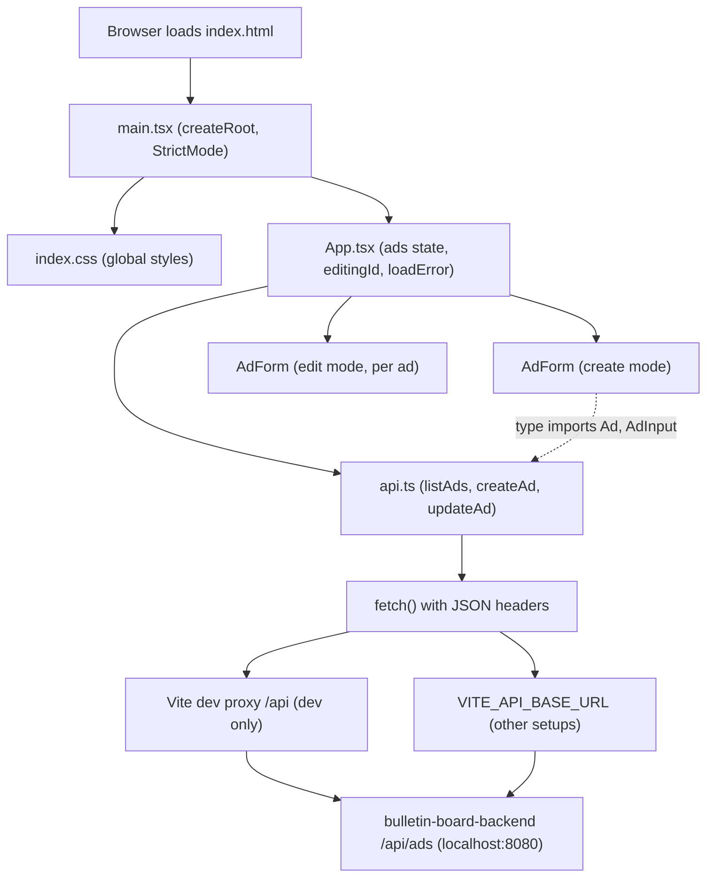
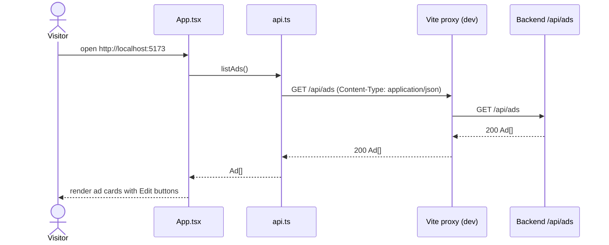
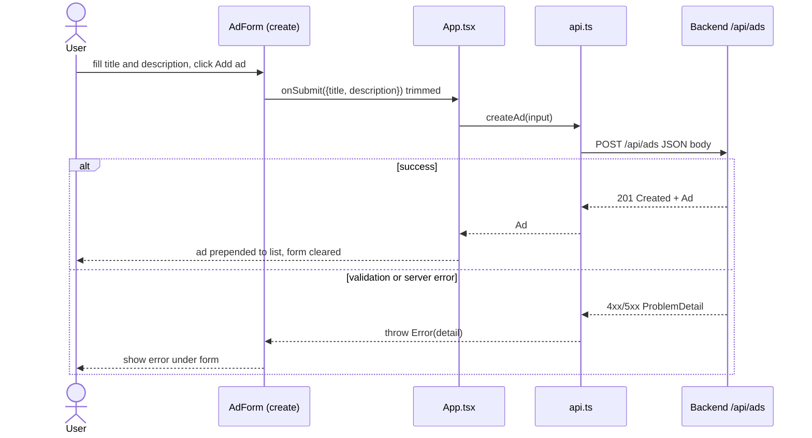
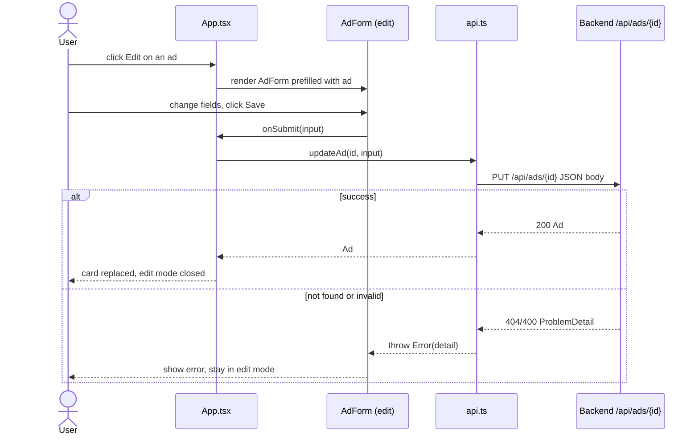

# Architecture: bulletin-board-frontend

## Architecture Analysis

### System Overview

A client-side single-page application (SPA) built with React 19 and TypeScript, bundled by Vite 8. It is one screen (`App`) that loads the list of ads from the backend REST API and lets the user create and edit ads through a reusable form component (`AdForm`). All HTTP traffic goes through one thin module (`src/api.ts`) built on the browser's native `fetch`.

In development the Vite dev server (http://localhost:5173) proxies `/api` to the Spring Boot backend at http://localhost:8080, so the browser sees one origin. For other deployments `VITE_API_BASE_URL` is set at build time and the backend must allow the frontend origin through CORS (`app.cors.allowed-origins`).

### Architectural Style

Monolithic client-side SPA, static assets only (no server-side rendering, no backend-for-frontend). Evidence: `index.html` loads `/src/main.tsx` as a module; `vite build` emits static files to `dist/`; no server code in the repo. It is the presentation tier of a two-tier system whose other tier is `bulletin-board-backend`.

Internal layering (by file, not by folder):

1. Bootstrap: `src/main.tsx`
2. View / container: `src/App.tsx` (state + handlers + list rendering)
3. Presentational form: `src/AdForm.tsx`
4. Data access: `src/api.ts` (types + REST calls)

### Component Relationships

Text fallback: the browser loads `index.html`, which runs `main.tsx`; `main.tsx` imports global CSS and renders `App` inside `StrictMode`. `App` renders one `AdForm` for creating and, for the ad being edited, a second `AdForm` in edit mode. `App` calls `api.ts` functions; `AdForm` imports only types from `api.ts`. `api.ts` calls `fetch`, which reaches the backend's `/api/ads` either through the Vite dev proxy (development) or directly at `VITE_API_BASE_URL` (other setups).

### Data Flow

- **Read**: on mount, `App` calls `listAds()` -> `GET /api/ads` -> `Ad[]` stored in `ads` state. On failure, `loadError` holds the message and the list shows an error line.
- **Create**: `AdForm` trims inputs and calls `onSubmit` -> `App.handleCreate` -> `createAd()` -> `POST /api/ads` -> the returned `Ad` is prepended to `ads`. The form clears itself on success.
- **Update**: clicking "Edit" sets `editingId`; the card is replaced by `AdForm` prefilled with the ad -> `App.handleUpdate` -> `updateAd(id)` -> `PUT /api/ads/{id}` -> the returned `Ad` replaces the old one in `ads`; edit mode closes.
- **Errors**: `api.ts` throws `Error(problem.detail ?? "Request failed with status N")`; `AdForm` catches create/update errors and shows them under the form.
- State lives only in React component state; nothing is persisted in the browser (no localStorage, sessionStorage or cookies).

### Key Design Decisions

| Decision | Evidence | Implication |
|---|---|---|
| No router; one screen | `App.tsx`, no router dependency | Simple, but any new screen (sign-up, log-in) needs a router or conditional rendering. |
| No global state library or React context | only `useState`/`useEffect` | A "current user" would have to be introduced as new shared state. |
| Native `fetch` behind one `request<T>()` helper | `api.ts` lines 17-27 | Single place to add credentials, auth headers and 401 handling. |
| Same-origin dev proxy | `vite.config.ts` lines 9-11 | Cookies would flow in dev without CORS; split-origin builds need backend CORS with credentials. |
| Errors follow RFC 9457 `ProblemDetail.detail` | `api.ts` line 24 | New backend errors (401/403) surface automatically if they use ProblemDetail. |
| Client-side validation mirrors the backend limits | `AdForm.tsx` `maxLength` 100/2000, `required` | Server remains the authority; client checks are convenience only. |

### Improvement Opportunities

- Introduce a test runner and at least component tests for `App` and `AdForm` (none exist).
- Add CI to run `npm run lint` and `npm run build` on pull requests.
- Enable `"strict": true` in `tsconfig.app.json`.
- Make `request()` tolerate bodiless responses (204) and centralise auth-failure handling.
- Separate container logic from rendering if more screens are added.

## Interaction Diagrams

### Browse ads (page load)

Text fallback: the visitor opens the page; `App` calls `listAds()`; `api.ts` sends `GET /api/ads` through the dev proxy to the backend; the backend returns the ad array; `App` renders one card per ad, each with an Edit button. On error, `App` shows "Could not load ads: <message>".

### Create an ad

Text fallback: the user submits the create form; `AdForm` trims the fields and calls `App.handleCreate`; `api.ts` posts JSON to `/api/ads`. On 201 the new ad is added to the top of the list and the form is cleared. On an error status the thrown message (the ProblemDetail `detail` or a status fallback) is shown under the form.

### Edit an ad

Text fallback: clicking Edit swaps the ad card for a prefilled `AdForm`; Save calls `App.handleUpdate`, which sends `PUT /api/ads/{id}`. On 200 the ad in the list is replaced and edit mode closes; on an error the message is shown and the form stays open. Cancel closes edit mode without a request. Any visitor can perform this on any ad today.
