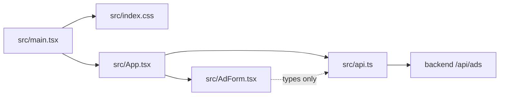

# Dependencies: bulletin-board-frontend

## External Package Dependencies

Runtime (shipped in the bundle): `react` and `react-dom` only. Dev-time: `vite`, `@vitejs/plugin-react`, `typescript`, `oxlint` and three `@types/*` packages. Versions are listed once in `technology-stack.md`.

The lockfile resolves 70 package entries in total (mostly platform-specific native binaries for rolldown, lightningcss and oxlint).

Currency check (as of the scan): all direct dependencies are on current major versions (React 19, Vite 8, TypeScript 6, plugin-react 6). No major version lag found. No security audit was run (no `node_modules` installed at scan time).

## External Service Dependencies

| Service | How it is reached | Required for | Config |
|---|---|---|---|
| bulletin-board-backend REST API (`/api/ads`) | `fetch` in `src/api.ts` | every feature (list, create, edit) | dev: Vite proxy to `http://localhost:8080`; other: `VITE_API_BASE_URL` + backend `app.cors.allowed-origins` |

Cross-repo coupling points with `bulletin-board-backend`:

- Resource path `/api/ads` and methods `GET`, `POST`, `PUT /{id}`.
- JSON shape of `Ad` / `AdInput` (`src/api.ts`) must match the backend's `AdResponse` / `AdRequest`.
- Validation limits duplicated client-side (title 100, description 2000).
- Error body format: ProblemDetail with `detail`.
- Backend CORS allow-list (default `http://localhost:5173`) and allowed methods (`GET, POST, PUT`), credentials not enabled.
- Backend port 8080 hard-coded in `vite.config.ts`.

## Internal Dependencies

Text fallback: `main.tsx` depends on `index.css` and `App.tsx`; `App.tsx` depends on `AdForm.tsx` and `api.ts`; `AdForm.tsx` imports only types from `api.ts`; `api.ts` depends on the backend over HTTP. No cycles.
