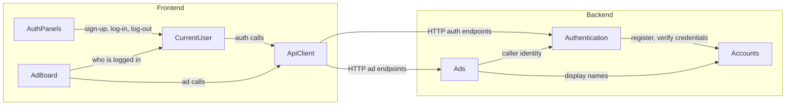

# Components: User Login for the Bulletin Board

Sources: `inception/requirements-analysis/requirements.md` (FR1–FR5, NFR1–NFR8), `domain-design-questions.md` (Q1–Q5), and the code knowledge base (`codekb/bulletin-board-backend/`, `codekb/bulletin-board-frontend/`). Decisions are recorded in `decisions.md` (ADR-001 to ADR-006).

The backend gains two building blocks, **Accounts** and **Authentication**, beside the existing **Ads** feature. The frontend gains a shared **CurrentUser** state and **AuthPanels**; the existing **AdBoard** screen and **ApiClient** are extended. Deployment grouping is left to Units Generation.

## Component Catalogue

```yaml
components:
  - name: Accounts
    summary: Owns user accounts: registration, credential verification and failed-login lockout.
    behaviour: >
      Registers an account from email, display name and password (FR1.1). Normalises the email
      (trim, case-insensitive) and enforces one account per email, including under concurrent
      sign-ups (FR1.2, FR1.3). Validates password length 8-128 and display name 1-50 visible
      characters (FR1.4, FR1.5). Stores only a salted adaptive password hash, never the password
      (NFR1). Verifies email + password for log-in; counts consecutive failures per account and locks
      the account for 15 minutes after 5 failures; a successful log-in resets the count; an expired
      lock allows log-in again (FR2.3-FR2.5). Exposes display names by account id for showing
      posters (FR5.1) and never exposes email addresses or hashes outside the backend (FR5.2, NFR2).
    responsibilities:
      - Account registration and validation of sign-up input
      - Email uniqueness
      - Password hashing and verification
      - Failed-attempt counting and temporary lockout
      - Display-name lookup by account id
    depends_on: []
    dependents:
      - component: Authentication
        interaction: register accounts at sign-up and verify credentials at log-in
      - component: Ads
        interaction: look up posters' display names when returning ads
    external_dependencies:
      - name: H2 in-memory database
        kind: database
        purpose: stores accounts; wiped on restart (C2)
      - name: Adaptive password-hashing function
        kind: other
        purpose: salted password hashing (NFR1)
    entities:
      - name: UserAccount
        identifier: id
        attributes: [id, email, displayName, passwordHash, failedLoginCount, lockedUntil, createdAt]

  - name: Authentication
    summary: Owns the login session: sign-up-and-log-in, log-in, log-out, current-user lookup, and request protection.
    behaviour: >
      Serves the sign-up, log-in, log-out and "who am I" operations. On successful sign-up or log-in
      it creates a new server-side session (replacing any earlier session id, NFR3) identified by an
      HttpOnly, same-site session cookie with no expiry date, so it ends when the browser closes
      (FR1.6, FR3.2). Log-out invalidates the session on the server immediately (FR3.1). Resolves the
      caller of every request to an account id or "anonymous" and hands that identity to the
      business logic. Requires a valid anti-forgery token on every state-changing request (NFR3).
      Refuses protected operations from anonymous callers with a "not logged in" problem detail
      (FR4.7, NFR7). Log-in failures return one generic message; a locked account returns the
      "temporarily locked" message (FR2.2, FR2.3). Never puts credentials or session ids in URLs
      or logs (NFR2).
    responsibilities:
      - Sign-up, log-in, log-out and current-user endpoints
      - Server-side session lifecycle
      - Identifying the caller of each request
      - Anti-forgery (CSRF) protection for state-changing requests
      - Refusing anonymous callers on protected operations
    depends_on:
      - component: Accounts
        interaction: register an account at sign-up; verify credentials and lockout at log-in; read display name for the current user
        style: sync
    dependents:
      - component: Ads
        interaction: obtain the identity of the caller for create and edit
      - component: ApiClient
        interaction: sign-up, log-in, log-out, current-user calls over HTTP
    external_dependencies:
      - name: Server session store (in-memory, servlet container)
        kind: other
        purpose: holds session state; lost on restart (C2, FR3.4)
    entities: []

  - name: Ads
    summary: Existing ads feature, extended with ownership: create, list, view and owner-only edit.
    behaviour: >
      Listing and viewing stay open to everyone (FR4.1). Creating requires an identified caller; the
      owner is set to the caller's account id by the server and never read from the request body
      (FR4.2). Editing requires an identified caller who is the ad's owner; a different user gets
      "not allowed", an anonymous caller gets "not logged in"; an edit never changes the owner, even
      if the body names one (FR4.3, FR4.4). Ads without an owner cannot be edited by anyone (FR4.5).
      Every ad returned carries the poster's display name, or "Unknown" for an unowned ad, and no
      email address (FR5.1-FR5.3). Responses report whether the caller owns the ad so the UI can
      show "Edit" only on own ads (FR4.6). Existing validation, ordering and problem-details errors
      are kept (NFR7).
    responsibilities:
      - Ad creation, listing, viewing and editing (existing)
      - Recording the owner of each new ad
      - Enforcing owner-only editing
      - Presenting the poster's display name on ads
    depends_on:
      - component: Authentication
        interaction: get the identity of the caller for create and edit
        style: sync
      - component: Accounts
        interaction: resolve owners' display names for returned ads
        style: sync
    dependents:
      - component: ApiClient
        interaction: list, view, create and edit ads over HTTP
    external_dependencies:
      - name: H2 in-memory database
        kind: database
        purpose: stores ads; wiped on restart (C2)
    entities:
      - name: Ad
        identifier: id
        attributes: [id, title, description, ownerId, createdAt, updatedAt]
        references:
          - entity: UserAccount
            owned_by: Accounts
            relationship: each Ad belongs to at most one UserAccount (its owner); unowned ads have none

  - name: ApiClient
    summary: Frontend gateway to the backend API, extended for sessions.
    behaviour: >
      Sends every request same-origin with the session cookie (NFR4). Attaches the anti-forgery token
      to state-changing requests (NFR3). Accepts empty (204) responses, e.g. on log-out. Turns a
      "not logged in" response into a signal the CurrentUser state can react to (FR3.4) and surfaces
      problem-details messages as errors (FR4.7, NFR7).
    responsibilities:
      - HTTP calls for ads and for sign-up, log-in, log-out and current user
      - Session cookie and anti-forgery token handling
      - Error and empty-response handling
    depends_on:
      - component: Authentication
        interaction: sign-up, log-in, log-out and current-user requests
        style: sync
      - component: Ads
        interaction: list, view, create and edit requests
        style: sync
    dependents:
      - component: CurrentUser
        interaction: authentication calls and session-ended signal
      - component: AdBoard
        interaction: ad calls
    external_dependencies: []
    entities: []

  - name: CurrentUser
    summary: Frontend shared state for who is logged in.
    behaviour: >
      Loads the current user on page load so a reload keeps the user logged in (FR3.3). Exposes
      sign-up, log-in and log-out actions and the logged-in user's id and display name to the rest
      of the UI (AC2.1). When any call reports the session has ended, it switches the UI to
      logged-out and asks the user to log in, without clearing forms the user is filling in (FR3.4).
    responsibilities:
      - Current-user state for the whole app
      - Sign-up, log-in and log-out actions
      - Reacting to an ended session
    depends_on:
      - component: ApiClient
        interaction: authentication requests and session-ended signal
        style: sync
    dependents:
      - component: AuthPanels
        interaction: trigger sign-up, log-in and log-out
      - component: AdBoard
        interaction: read who is logged in to decide what to show
    external_dependencies: []
    entities: []

  - name: AuthPanels
    summary: Frontend sign-up and log-in panels and the log-out control on the existing single screen.
    behaviour: >
      Shows log-in and sign-up as panels on the existing screen, with no routing library (Q4).
      Fields have visible labels, work by keyboard alone, and show errors as text naming the field
      (FR1.7, NFR8). Keeps typed input except the password after an error (FR1.7). Shows the logged-in
      user's display name and a "Log out" control (AC2.1, AC3.1). Shows the locked-account and
      generic log-in messages returned by the backend (AC2.2-AC2.4).
    responsibilities:
      - Sign-up form
      - Log-in form
      - Logged-in indicator and log-out control
    depends_on:
      - component: CurrentUser
        interaction: perform sign-up, log-in and log-out; read the current user
        style: sync
    dependents: []
    external_dependencies: []
    entities: []

  - name: AdBoard
    summary: Existing frontend board (list, new-ad form, inline edit), made ownership-aware.
    behaviour: >
      Shows the list of ads with each poster's display name to everyone (FR4.1, FR5.1). Shows the
      "New ad" form only when logged in, and "Edit" only on ads the logged-in user owns (FR4.6,
      AC4.1). Displays user-supplied text, including display names, as literal text and never as
      markup. Shows refusal messages from the backend (FR4.7). Keeps form input when a save is
      refused because the session ended (AC3.4).
    responsibilities:
      - Ad list with poster names
      - New-ad form for logged-in users
      - Inline edit for the owner's own ads
    depends_on:
      - component: CurrentUser
        interaction: read who is logged in
        style: sync
      - component: ApiClient
        interaction: list, create and edit ads
        style: sync
    dependents: []
    external_dependencies: []
    entities: []
```

## Component Diagram



Text fallback: in the frontend, AuthPanels and AdBoard use CurrentUser; AdBoard and CurrentUser call the backend through ApiClient. ApiClient calls Authentication (sign-up, log-in, log-out, current user) and Ads (list, view, create, edit). In the backend, Ads asks Authentication who the caller is and asks Accounts for display names; Authentication uses Accounts to register accounts and verify credentials. There are no cycles.

## Component Summary

| Component | Purpose | Depends On | Dependents | Entities Owned |
|---|---|---|---|---|
| Accounts | Registration, credential check, lockout, display names | none | Authentication, Ads | UserAccount |
| Authentication | Session, sign-up/log-in/log-out, caller identity, CSRF | Accounts | Ads, ApiClient | none |
| Ads | Ads with ownership and poster names | Authentication, Accounts | ApiClient | Ad |
| ApiClient | Frontend HTTP gateway with session and CSRF handling | Authentication, Ads | CurrentUser, AdBoard | none |
| CurrentUser | Frontend "who is logged in" state and auth actions | ApiClient | AuthPanels, AdBoard | none |
| AuthPanels | Sign-up and log-in panels, log-out control | CurrentUser | none | none |
| AdBoard | Board with owner-aware create and edit | CurrentUser, ApiClient | none | none |

## Entity Ownership

| Entity | Owning Component | Identifier | Attributes | References |
|---|---|---|---|---|
| UserAccount | Accounts | id | id, email, displayName, passwordHash, failedLoginCount, lockedUntil, createdAt | none |
| Ad | Ads | id | id, title, description, ownerId, createdAt, updatedAt | UserAccount (Accounts): each Ad belongs to at most one UserAccount |

## External Dependencies

| Component | Dependency | Kind | Purpose |
|---|---|---|---|
| Accounts | H2 in-memory database | database | Stores accounts; wiped on restart |
| Accounts | Adaptive password-hashing function | other | Salted password hashes |
| Authentication | Server session store (in-memory) | other | Session state; lost on restart |
| Ads | H2 in-memory database | database | Stores ads; wiped on restart |

## Rationale

| Component | Why it is a separate building block |
|---|---|
| Accounts | Distinct data ownership (user records, credentials) and a distinct change rate: future password reset, email verification or profile editing land here (ADR-002). |
| Authentication | Distinct concern: request-level security (session, CSRF, caller identity) changes with the hosting and security model, not with account data (ADR-001, ADR-002, ADR-006). |
| Ads | Existing feature package; ownership is added inside it so the owner-only rule sits next to the data it protects (ADR-003, ADR-005). |
| ApiClient | Existing single choke point for HTTP; session and CSRF handling belong in one place. |
| CurrentUser | Distinct lifecycle: app-wide state that both auth panels and the board read (ADR-004). |
| AuthPanels | Distinct UI concern with its own forms and validation messages (ADR-004). |
| AdBoard | Existing screen; only its visibility rules change. |

**Alternatives Rejected (boundaries):** a single Identity component (rejected: mixes account data with request security, ADR-002); users inside the Ads feature (rejected: account data has nothing to do with ads and would grow there); a routed multi-page frontend (rejected by the team in favour of panels, ADR-004).
