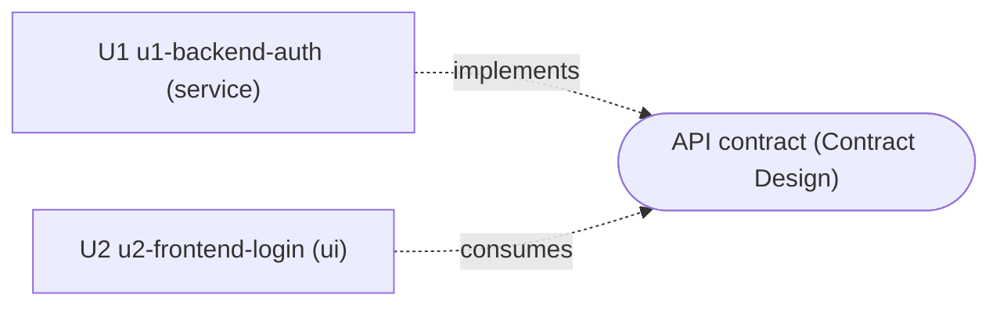

# Unit Dependencies: User Login for the Bulletin Board

## Dependency DAG

There are no dependency edges between the units (Q2). U2 builds against the API contract that Contract Design pins, not against U1's running code. The two meet at integration.



Text fallback: U1 implements the API contract and U2 consumes it. Neither unit depends on the other, so the graph has no edges and no cycles.

## Machine-Readable Edge Block

```yaml
units:
  - name: u1-backend-auth
    kind: service
    depends_on: []
  - name: u2-frontend-login
    kind: ui
    depends_on: []
```

## Integration Points

| Between | Mechanism | What crosses | Defined in |
|---|---|---|---|
| U2 → U1 | Synchronous HTTP JSON, same origin (`/api`) | Sign-up, log-in, log-out and current-user calls; ad list, view, create and edit calls; the session cookie; the anti-forgery token (cookie plus header); problem-details errors | Contract Design (next stage) |

No shared data store or events: U2 holds no persistent data.

## Parallel Development Opportunities

- {U1, U2} can be developed fully in parallel, because neither has a dependency edge on the other.
- Valid topological orderings: U1 then U2, U2 then U1, or both at once.
- End-to-end checks (sign-up, log-in, owner-only edit through the UI) need both units together. That integration step belongs to Build and Test.
